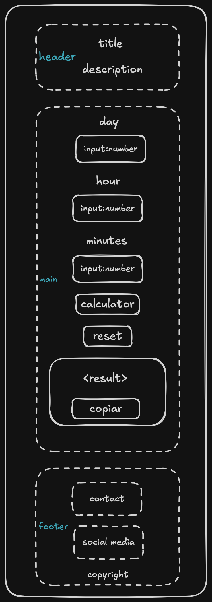
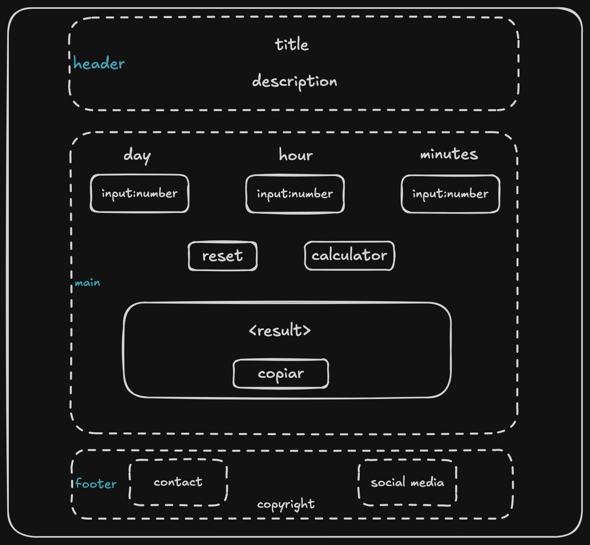

# estimate-calculator

## 📌 Table of Contents

- [About](#-about)
- [Wireframe](#wireframe)

---

## 📖 About

The project proposal is to guarantee an easier way to calculate the estimate value using hours as a base unit.

---

### Wireframe

Mobile

Desktop

